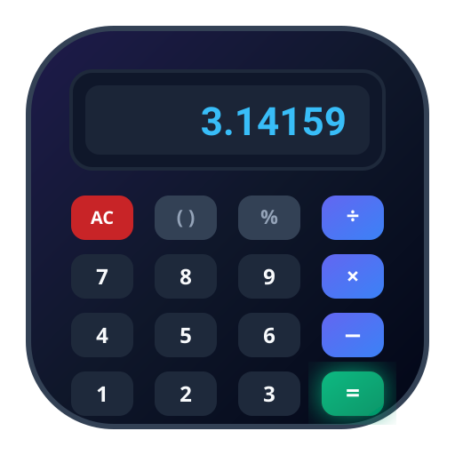

<div align="center">

  

  # 🧮 PyCalc — Modern Scientific Calculator
  ### Kalkulator Saintifik Responsif Berbasis Python (Desktop & Mobile)

  <p align="center">
    Aplikasi kalkulator saintifik modern dengan antarmuka web ultra-responsif, dibangun murni menggunakan <strong>Python Standard Library</strong> tanpa dependensi pihak ketiga (0 external dependencies). Kompatibel penuh untuk <strong>Desktop (PC/Laptop)</strong> dan <strong>Mobile (Android & iOS)</strong>.
  </p>

  <p align="center">
    <a href="#-fitur-utama">Fitur</a> •
    <a href="#-cara-menjalankan">Instalasi</a> •
    <a href="#-panduan-penggunaan-desktop--mobile">Panduan Penggunaan</a> •
    <a href="#-pintasan-keyboard-desktop">Pintasan Keyboard</a> •
    <a href="#-arsitektur-dan-keamanan">Keamanan</a> •
    <a href="#-dokumentasi-api">API</a>
  </p>

  <p align="center">
    
    
    
    
  </p>

</div>

---

## 🌟 Mengapa PyCalc?

Banyak aplikasi kalkulator Python berbasis GUI (seperti Tkinter atau PyQt) hanya dapat berjalan di komputer desktop dan tidak dapat dibuka di smartphone. **PyCalc** hadir dengan arsitektur web modern yang menjembatani kebutuhan komputasi Python dengan fleksibilitas multi-perangkat:

1. **Jalankan Sekali di Laptop**: Server HTTP Python bawaan langsung aktif.
2. **Buka di Mana Saja**: Langsung gunakan di layar monitor laptop Anda, atau akses melalui smartphone (Android/iPhone) di jaringan Wi-Fi yang sama hanya dengan memindai **QR Code**.
3. **Tanpa Instalasi Tambahan**: Cukup punya Python di komputer, tidak perlu `pip install` paket apapun.

---

## ✨ Fitur Utama

### 📱 Antarmuka Multi-Device & Responsif
* **Desktop Mode**: Tampilan luas dengan tata letak dua kolom (keypad saintifik + keypad standar), bilah riwayat di samping, dan dukungan pintasan keyboard fisik lengkap.
* **Mobile Portrait Mode**: Tombol berukuran ergonomis (*touch target* $\ge 48\text{px}$) dengan tab pemindah (*Standar* vs *Saintifik (fx)*) yang nyaman untuk penggunaan satu tangan.
* **Mobile Landscape & Tablet**: Tata letak otomatis menyesuaikan menjadi dua kolom berdampingan.
* **Progressive Web App (PWA)**: Dilengkapi `manifest.json` sehingga dapat ditambahkan ke Layar Utama (*Add to Home Screen*) di Android & iOS tanpa bilah alamat browser.
* **Koneksi QR Code Cepat**: Modal popup yang menampilkan QR Code dan IP LAN komputer Anda untuk akses instan dari ponsel pintar.

### 🔬 Komputasi Saintifik Lengkap
* **Aritmatika Dasar**: Tambah (`+`), Kurang (`−`), Kali (`×`), Bagi (`÷`), Persentase (`%`), Modulo (`mod`).
* **Trigonometri**: `sin`, `cos`, `tan`, serta fungsi invers `asin`, `acos`, `atan` dan hiperbolik `sinh`, `cosh`, `tanh`.
* **Mode Sudut Fleksibel**: Beralih instan antara mode **DEG** (Derajat) dan **RAD** (Radian).
* **Pangkat & Akar**: $x^y$, $x^2$, $\sqrt{x}$, $\sqrt[3]{x}$, eksponensial $e^x$, dan basis 10 ($10^x$).
* **Logaritma**: Logaritma natural (`ln`), logaritma basis 10 (`log`), dan logaritma basis 2 (`log2`).
* **Fungsi Khusus**: Faktorial ($n!$), Nilai Mutlak ($|x|$), Resiprokal ($1/x$).
* **Konstanta Matematika**: $\pi$ (`pi`), $e$ (Euler), $\tau$ (`tau`).

### 💾 Memori & Riwayat Kalkulasi
* **Operasi Memori Lengkap**: `MC` (Clear), `MR` (Recall), `M+` (Add), `M−` (Subtract), `MS` (Store).
* **Riwayat Perhitungan**: Riwayat kalkulasi tersimpan otomatis. Klik item riwayat untuk memasukkan kembali rumus ke layar atau menyalin hasilnya.

### 🎨 Desain Visual & Pengalaman Pengguna
* **Tema Gelap & Terang**: Dilengkapi tombol pengalih tema (*Dark Glassmorphism* dan *Clean Light Theme*).
* **Efek Suara Realistis**: Menggunakan *Web Audio API* untuk menghasilkan suara klik mekanis taktil yang memuaskan.
* **Haptic Feedback**: Getaran responsif saat menekan tombol pada layar sentuh smartphone.
* **Live Calculation Preview**: Pratinjau hasil hitungan secara langsung (*real-time*) sebelum menekan tombol sama dengan (`=`).

---

## 🚀 Cara Menjalankan

### 1. Prasyarat
* Komputer dengan **Python 3.10** atau versi lebih baru terpasang.
* Tanpa perlu instalasi paket tambahan melalui `pip`.

### 2. Kloning atau Unduh Repositori
```bash
git clone https://github.com/username/kalkulator-python.git
cd kalkulator-python
```

### 3. Jalankan Aplikasi
Jalankan file server utama:
```bash
python app.py
```

Anda juga dapat menentukan nomor port khusus jika diinginkan:
```bash
python app.py 8080
```

---

## 📖 Panduan Penggunaan Desktop & Mobile

Saat server dijalankan, terminal akan menampilkan informasi alamat server:

```text
==============================================================
 🧮  KALKULATOR SAINTIFIK MODERN PYTHON  (DESKTOP & MOBILE)
==============================================================
 Server lokal berhasil berjalan!

 💻 Untuk Desktop / Komputer:
    👉 http://localhost:8000
    👉 http://127.0.0.1:8000

 📱 Untuk Smartphone / Mobile (HP di Wi-Fi yang sama):
    👉 http://192.168.x.x:8000
==============================================================
```

### 💻 Penggunaan di Desktop (PC / Laptop)
1. Buka browser favorit Anda (Google Chrome, Microsoft Edge, Mozilla Firefox, dll).
2. Kunjungi tautan: **`http://localhost:8000`**
3. Anda dapat langsung menggunakan mouse maupun keyboard fisik Anda.

### 📱 Penggunaan di Smartphone (Android & iOS)
1. Pastikan ponsel Anda dan laptop/komputer terhubung ke **jaringan Wi-Fi yang sama**.
2. **Cara Cepat**: Di tampilan desktop, klik tombol **Smartphone** di navigasi atas, lalu **arahkan kamera ponsel Anda ke QR Code** yang muncul di layar.
3. **Cara Manual**: Buka browser di ponsel (Chrome atau Safari) dan ketik alamat IP yang tertera di terminal (contoh: `http://192.168.100.8:8000`).
4. **Jadikan Aplikasi Native (PWA)**:
   * **Android (Chrome)**: Ketuk menu titik tiga (⋮) $\rightarrow$ pilih **"Tambahkan ke Layar Utama" / "Install app"**.
   * **iOS (Safari)**: Ketuk tombol Share ($\uparrow$) $\rightarrow$ pilih **"Add to Home Screen"**.

---

## ⌨️ Pintasan Keyboard Desktop

Pengguna desktop dapat mengoperasikan kalkulator sepenuhnya tanpa perlu menyentuh mouse:

| Tombol Keyboard | Aksi / Fungsi |
| :--- | :--- |
| `0` s/d `9` | Memasukkan angka |
| `.`, `,` | Titik desimal |
| `+`, `-`, `*`, `/` | Penjumlahan, pengurangan, perkalian, pembagian |
| `Enter` atau `=` | Mengeksekusi hasil perhitungan |
| `Backspace` | Menghapus 1 karakter terakhir |
| `Escape` atau `Delete` | Menghapus semua (*All Clear / AC*) |
| `(` dan `)` | Tanda kurung matematika |
| `^` | Pangkat ($x^y$) |
| `!` | Faktorial ($n!$) |
| `%` | Persentase / Modulo |
| `s`, `c`, `t` | Trigonometri `sin(`, `cos(`, `tan(` |
| `r` | Akar kuadrat $\sqrt{x}$ (`sqrt(`) |
| `l`, `n` | Logaritma $\log_{10}($ dan $\ln($ |
| `p`, `e` | Konstanta $\pi$ dan $e$ |

---

## 📁 Struktur Berkas

```
kalkulator-python/
│
├── app.py                  # Server HTTP & REST API (Python Standard Library)
├── calculator_engine.py    # Mesin parser matematika berbasis AST & math
├── test_server.py          # Skrip unit test & integration test otomatis
├── README.md               # Dokumentasi proyek untuk GitHub
│
└── static/
    ├── index.html          # Struktur antarmuka HTML5 semantik & PWA
    ├── style.css           # Desain Glassmorphism, CSS Grid, & responsivitas
    ├── script.js           # Logika interaktif, Web Audio, haptics, keyboard
    ├── manifest.json       # Metadata Progressive Web App (PWA)
    └── icon.svg            # Ikon vektor aplikasi beresolusi tinggi
```

---

## 🛡️ Arsitektur dan Keamanan

Banyak kalkulator Python berbasis web secara naif mengeksekusi ekspresi string menggunakan fungsi `eval()`, yang sangat berbahaya karena membuka celah injeksi kode berbahaya (*Remote Code Execution*).

**PyCalc mengadopsi prinsip *Defense in Depth*:**
* Menggunakan **Abstract Syntax Tree (`ast.parse`)** untuk membedah struktur rumus menjadi pohon sintaks matematika murni.
* Menerapkan daftar putih (*strict whitelist*) hanya untuk tipe node: `ast.Constant`, `ast.BinOp`, `ast.UnaryOp`, `ast.Call`, dan `ast.Name`.
* Memvalidasi fungsi matematika yang diizinkan hanya dari modul `math` standar.
* Mencegah serangan *Denial-of-Service* (DoS) kalkulasi eksponen raksasa dan pembagian dengan nol dengan penanganan galat (*exception handling*) yang ramah pengguna.

---

## 🔌 Dokumentasi API

Aplikasi ini menyertakan REST API bawaan yang dapat diintegrasikan dengan aplikasi lain:

### 1. Hitung Ekspresi Matematika
* **Endpoint:** `POST /api/calculate`
* **Request Body:**
  ```json
  {
    "expression": "sin(30) + sqrt(16) * 2",
    "angle_unit": "DEG"
  }
  ```
* **Response:**
  ```json
  {
    "success": true,
    "expression": "sin(30) + sqrt(16) * 2",
    "result": 8.5,
    "display": "8.5",
    "angle_unit": "DEG"
  }
  ```

### 2. Dapatkan Riwayat Kalkulasi
* **Endpoint:** `GET /api/history`
* **Response:**
  ```json
  {
    "success": true,
    "history": [
      {
        "id": 1,
        "expression": "sin(30) + sqrt(16) * 2",
        "result": 8.5,
        "display": "8.5",
        "angle_unit": "DEG",
        "timestamp": "14:20:05"
      }
    ]
  }
  ```

### 3. Informasi Jaringan & IP Lokal
* **Endpoint:** `GET /api/info`
* **Response:**
  ```json
  {
    "success": true,
    "port": 8000,
    "local_ip": "192.168.100.8",
    "desktop_url": "http://localhost:8000",
    "mobile_url": "http://192.168.100.8:8000"
  }
  ```

---

## 🧪 Pengujian Otomatis

Untuk memastikan seluruh fungsi matematika dan endpoint web berjalan dengan sempurna, jalankan suite pengujian:

```bash
python test_server.py
```

---

## 🤝 Berkontribusi

Kontribusi selalu disambut dengan baik! Jika Anda memiliki ide perbaikan atau fitur baru:
1. *Fork* repositori ini
2. Buat *branch* fitur Anda (`git checkout -b fitur/FiturKeren`)
3. *Commit* perubahan Anda (`git commit -m 'Menambahkan fitur keren'`)
4. *Push* ke *branch* Anda (`git push origin fitur/FiturKeren`)
5. Buka sebuah *Pull Request*

---

## 📄 Lisensi

Didistribusikan di bawah Lisensi **MIT**. Silakan gunakan, modifikasi, dan kembangkan untuk keperluan pribadi maupun komersial.

<div align="center">
  Dibuat dengan ❤️ menggunakan Python murni.
</div>
